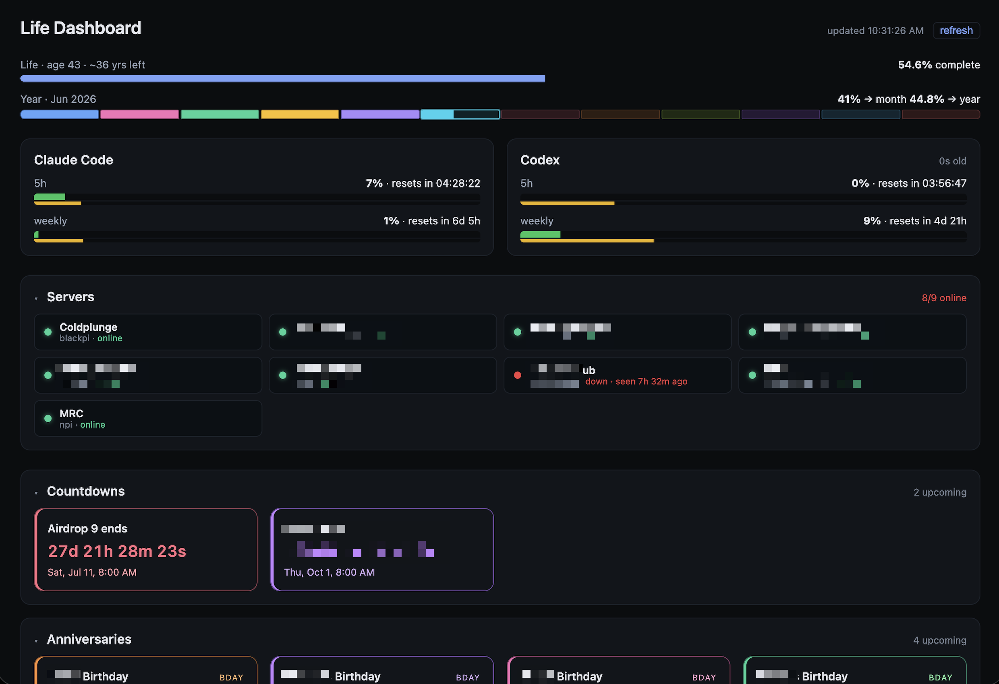

# Life Dashboard

A self-hosted personal dashboard. At a glance it shows:

- **Life & year progress** — what fraction of your life expectancy you've lived
  (age, years remaining) plus a 12-month strip for the current year, color-coded
  by month, with the live month filling in real time.
- **AI usage limits** — live Claude Code and Codex rate-limit gauges for every
  window the account currently exposes, with reset countdowns.
- **Analytics** — grouped bar charts of recent daily metrics per location (e.g.
  batches/photos generated and prints requested/completed), driven entirely by
  numbers you keep in config.
- **Checklists** — recurring daily/weekly/specific-weekday tasks, grouped into
  labeled sections, with a day-by-day navigator so you can review what you got
  done or missed on any date.
- **Oura Ring** — last night's sleep summary plus today's step count, fetched
  from Oura's V2 API.
- **Live log** — a business "what happened overnight" panel: stat tiles plus a
  merged, reverse-chronological activity feed (e.g. signups, newsletter opt-ins,
  purchases, trial starts and conversions) pulled from any JSON HTTP endpoints
  you configure, with optional wallet-signature login.
- **Servers** — online/offline status of your Tailscale machines.
- **Countdowns & Anniversaries** — upcoming calendar events and recurring
  birthdays/anniversaries, split into two panels (Countdowns ordered
  soonest-first; Anniversaries ordered by upcoming year milestone).

Most settings read from `config.local.json`; OAuth integrations also use local
environment variables and `.cache/` token files. Sections you don't configure are
simply omitted.

The **GPUs** tab takes an on-demand health snapshot of your configured machines.
It shows per-GPU utilization, temperature, memory, power, driver version, CPU,
available RAM, disks, cached OS updates, reboot requirements, and a bounded
sample of system errors. Findings explain both the reading and what to review.
Temperatures use Fahrenheit; timestamps use Pacific Time.

Add hosts to the gitignored `config.local.json` using SSH aliases that already
work from the dashboard machine:

```json
"gpuHosts": [
  { "id": "gpu-one", "label": "GPU workstation", "group": "Workstations", "sshHost": "my-gpu", "platform": "linux" },
  { "id": "gpu-two", "label": "Windows GPU", "group": "Workstations", "sshHost": "user@my-windows-gpu", "platform": "windows" }
]
```

An optional `jumpHost` uses an existing SSH jump route. Linux hosts need Python 3;
Windows hosts use PowerShell. NVIDIA readings require `nvidia-smi`. Configure SSH
keys and verified host keys beforehand: checks are non-interactive, use strict
host-key checking, and never forward your SSH agent. Private hostnames and
addresses stay in local config; they are not returned by the GPU API.

GPU checks run **only when opening the GPUs tab or pressing Refresh snapshot**.
Navigation prefetch is disabled. There is no timer, cron, persistent SSH session,
installed agent, or database. Concurrent visits share an in-progress check;
at most four hosts are checked at once, with a 35-second timeout per host. A
check already started finishes if its browser leaves. No GPU workloads are
started or changed. The Overview retains its existing refresh behavior.

OS updates are read from local APT lists or the offline Windows Update cache;
the dashboard never refreshes repositories, downloads updates, or applies them.
Cache age is shown. Driver versions describe installed drivers, not whether an
online release is newer. Sparks' unavailable dedicated VRAM readings remain
unknown; available system RAM describes their shared pool. WSL readings describe
the Linux guest, and are labeled accordingly. Error logs are limited to the last
30 kernel/Windows System errors within 24 hours; Linux failed systemd units are
also checked. Sensor and permission gaps are shown explicitly.

The **Workers** tab shows what your Sogni workers earn and whether any need a
look. For each worker it reports today so far, yesterday, this month and last
month as two figures: estimated payout (SOGNI credited for pay-as-you-go jobs,
valued when earned, plus the worker's share of the month's Unlimited pool) and
list value (the same jobs at the public job price). It charts the last 30 days,
totals the last three months per Sogni account (several workers can earn under
one account), and flags workers that are offline, stopped, unhealthy, recently
restarted, failing jobs, or doing under half their usual work. Days are UTC
days; clock times use the viewer's time zone.

```json
"workers": {
  "historyUrl": "https://api.example.com/v1/analytics/chart/daily/events/query",
  "poolUrl": "https://api.example.com/v1/leaderboard/subscription-workers",
  "workers": [
    { "id": "gpu-one", "label": "GPU workstation", "group": "Workstations", "account": "my-account", "nftTokenId": "123",
      "checks": [{ "sshHost": "my-gpu", "container": "comfy-worker-0", "label": "Worker container" }] },
    { "id": "mac", "label": "Mac", "group": "Mac", "account": "my-mac-account", "address": "0x0000000000000000000000000000000000000000", "network": "relaxed",
      "checks": [{ "sshHost": "my-mac", "process": "Sogni", "label": "Sogni app" }] }
  ]
}
```

Earnings come from the network's public per-worker daily records and its public
monthly pool board, so no login or API key is used. A worker is identified by
its worker NFT number or, for a Mac, by wallet address and network. `account`
names the Sogni account the worker earns under (defaults to the label).
`checks` are optional: each names a Docker container or a process on a machine
the dashboard can already reach over SSH, read with `docker inspect` or `pgrep`.
A worker can list several, for example a model server on a second machine.

Like the GPUs tab, the Workers tab works only on demand: it loads when opened or
refreshed, shares an in-progress snapshot between visits, opens at most four SSH
sessions at a time, and changes nothing on a worker. API reads are reused for
one minute. The pool board's figure covers the whole month while the work covers
only the days so far, so the month in progress is priced on the elapsed share of
its pool; earlier months stay estimates until their pool is finalized.

The **Locations** tab groups Sensibo and Aranet4 monitors by location. Each card
is named after the room it measures and shows the current temperature in
Fahrenheit, humidity, measurement age, Aranet CO₂ and battery where reported, and
the AC's state. When Sensibo Climate React is on, the card states its rule (for
example, on above 90°F and off below 79°F), so a warm room with the AC off reads
as expected rather than broken. Below the cards, an interactive 24-hour chart
draws one line per room in the same color as that room's card, labelled by room
name. New Sensibo devices appear automatically under their Sensibo location.
Location cards and climate data are separate from the overview, so machine
telemetry can be added to each location without restructuring the home page.

To connect climate data, add `climate` to your gitignored `config.local.json`:

```json
"climate": {
  "hubUrl": "http://room-climate:8787",
  "sensiboKeyFile": "~/.config/sensibo/credentials",
  "timeZone": "Asia/Singapore",
  "sensorLabels": {}
}
```

`hubUrl` points to the existing Room Climate logger's `/api/cards` service for
Aranet readings and stored trends. `sensiboKeyFile` is a local file containing
`SENSIBO_API_KEY=...`; the key is read only by the dashboard server and never
returned to browsers. Sensibo supplies each device's location, current reading,
AC state, and its available one-day history. A new device's chart starts with
its first actual measurement. `sensorLabels` optionally maps a source ID
(`sensibo-<device id in lowercase>` or the Aranet card ID) to the room name shown
on the card and chart, such as `"sensibo-abc123": "Server room"`; without one,
the Sensibo room name is used. No credentials, sensor IDs, or private addresses belong
in committed config.

The page checks once per minute. Server-side reads are shared across browser
tabs, and Sensibo history is fetched at most once per five minutes. Measurements
older than 15 minutes are labeled stale. Provider failures are shown explicitly;
previous readings retain their original timestamps and are labeled unavailable.
This tab only reads sensors and AC settings; it does not send AC commands.



## Requirements
- Node 22+ (24 recommended)
- macOS or Linux (paths assume `~/.claude` and `~/.codex`)
- Both Claude Code and Codex must have been run at least once on this machine
  (for the usage gauges)
- The Tailscale CLI on this host, and this host joined to your tailnet, for the
  Servers panel (optional — leave `tailscaleHosts` empty to hide it)
- An Oura developer app with the `daily` scope, for the Oura panel (optional)

## Setup
```bash
npm install
cp config.example.json config.local.json
# Edit config.local.json — see "Configuration" below.
npm run dev
# Open http://127.0.0.1:3000
```

To run on a different port, set `PORT`:
```bash
PORT=3100 npm run dev
```

For production, build once and serve:
```bash
npm run build
npm start            # binds 127.0.0.1 (honors PORT)
```

### Reaching the dashboard from your other machines
`npm start` binds loopback unless `HOST` says otherwise. Set `HOST=tailscale` to
bind this machine's tailnet address instead, so any device on your tailnet can
reach the dashboard — and nothing on the local LAN can:
```bash
HOST=tailscale PORT=3002 npm start
# http://<this-machine>.<your-tailnet>.ts.net:3002
```
The address is resolved at startup from the machine's `100.64.0.0/10` interface,
so it survives a Tailscale IP change. If Tailscale isn't connected yet the
launcher waits up to 60s, then falls back to `127.0.0.1` rather than failing —
restart once Tailscale is up. `HOST` also accepts a literal address if you want
to pin one.

## Configuration

Dashboard settings live in `config.local.json` (gitignored). `config.example.json`
is a complete, working template. OAuth credentials use local environment
variables. Every key is optional; omit a section to hide its panel.

```json
{
  "icsUrl": null,
  "manualEvents": [
    { "title": "Flight to Tokyo", "start": "2026-06-15T08:00:00Z", "pinned": true },
    { "title": "Product launch",  "start": "2026-07-01T17:00:00-05:00" },
    { "title": "Tax deadline",    "start": "2027-04-15" }
  ],
  "birthdays": [
    { "name": "Ada",   "month": 12, "day": 10, "year": 1815 },
    { "name": "Grace", "month": 12, "day": 9 },
    { "name": "Ada & Charles", "type": "anniversary", "label": "Wedding", "month": 7, "day": 8, "year": 1835 }
  ],
  "pinnedEvents": ["Flight"],
  "refreshSeconds": 60,
  "life": { "birthDate": "1990-01-15", "expectancyYears": 80 },
  "tailscaleHosts": [
    { "host": "myserver", "alias": "Cold plunge" },
    { "host": "office.tailXXXXX.ts.net", "alias": "Office box" },
    { "host": "100.64.0.1", "alias": "By IP" }
  ],
  "checklists": {
    "title": "Daily Checklists",
    "weekStart": "mon",
    "groups": ["Morning", "Nightly", "Weekly"],
    "items": [
      { "group": "Morning", "label": "Cold plunge" },
      { "group": "Morning", "label": "Supplements" },
      { "group": "Nightly", "label": "Supplements" },
      { "group": "Weekly",  "label": "Long run",  "repeat": "weekly" },
      { "group": "Weekly",  "label": "Meal prep", "repeat": ["sun"] }
    ]
  }
}
```

### Events (Countdowns & Anniversaries)

Events come from two sources, merged together (duplicates removed, pinned events
bubble to the top):

- **`manualEvents`** — a JSON array you maintain by hand. `start` accepts any
  string `Date.parse` understands: ISO 8601 (`"2026-06-15T08:00:00Z"`), a
  date-only string (`"2026-09-12"`, treated as midnight UTC), or a verbose form
  like `"Jul 1 2026 17:00:00 GMT+0800"`. `pinned: true` sorts an event to the top.
  Past events are dropped automatically unless `keepPast: true`; retained events
  continue counting below zero after their start time.
- **`icsUrl`** — a private `.ics` URL (e.g. Google Calendar's "Secret address in
  iCal format"). Set to `null` to disable. Note: Google Workspace organizational
  calendars only expose a *public* iCal URL, not a secret one — manual entries are
  usually the right answer for work-managed accounts. Can also be supplied via the
  `ICS_URL` environment variable, which overrides the file value.

**`pinnedEvents`** is a list of keywords; any event (from either source) whose
title contains one of them (case-insensitive substring) is pinned.

Events are split into two panels on the dashboard:

- **Countdowns** — everything else. Ordered soonest-ending first.
- **Anniversaries** — `birthdays`/anniversaries (see below) and any event whose
  title contains "birthday" or "anniversary". Ordered by upcoming year milestone
  (turning 4, turning 44, …), smallest first; entries without an origin `year`
  have no milestone and fall to the end by calendar date.

Pinned events are kept on top in both panels, and both are collapsible.

### Birthdays & anniversaries

**`birthdays`** are recurring annual events, rendered in the Anniversaries panel:

- `name`, `month` (1–12), `day` (1–31) are required. Each entry automatically
  rolls to its next occurrence, so it's always a countdown to the next one.
- `type` is `"birthday"` (default) or `"anniversary"`. Birthdays title as
  *"<name>'s Birthday"* and show a `BDAY` badge; anniversaries title as the
  `name` and show an `ANNIV` badge — so not everything is assumed to be a birthday.
- `label` (optional) overrides the title outright, e.g. `"Wedding"`.
- `year` (optional) is the origin year — birth year, wedding year, etc. When
  present the card shows the upcoming count of years elapsed (the age, for a
  birthday); when omitted it shows just the countdown and date.

### Life progress

**`life`** powers the progress bars at the top:

- `birthDate` — ISO date (`"1990-01-15"`).
- `expectancyYears` — used to compute the "% of life complete" bar (age and
  estimated years remaining).
- The year strip below it is purely calendar-driven (month + year percentages),
  independent of `life`.

Omit `life` to hide the top bars.

### Checklists

**`checklists`** powers the Checklists panel — recurring tasks you tick off each
day, with a `‹ / ›` navigator to move one day at a time through history.

```json
"checklists": {
  "title": "Daily Checklists",
  "weekStart": "mon",
  "groups": ["Morning", "Lunch", "Dinner", "Nightly", "Weekly"],
  "items": [
    { "group": "Morning", "label": "Cold plunge" },
    { "group": "Morning", "label": "Olive oil" },
    { "group": "Lunch",   "label": "Olive oil" },
    { "group": "Weekly",  "label": "Long run",  "repeat": "weekly" },
    { "group": "Weekly",  "label": "Meal prep", "repeat": ["sun"] },
    { "group": "Weekly",  "label": "Trash out", "repeat": ["mon", "thu"] }
  ]
}
```

- `title` — panel heading (defaults to `"Checklists"`).
- `weekStart` — the weekday a week rolls over on, for weekly items (`"mon"`
  default … `"sun"`; 3-letter or full names).
- `groups` (optional) — fixes the display order of the labeled sections. Groups
  used by items but not listed here are appended in first-seen order; items with
  no `group` render last without a header.
- `items` — each needs a `label`. Optional `group`, optional `repeat`, and an
  optional explicit `id`.
- `repeat` controls cadence (defaults to `"daily"`):
  - `"daily"` — appears every day.
  - `"weekly"` — appears every day until you check it once; that completes the
    whole week (it stays checked through the configured week boundary).
  - `["mon", "wed", "fri"]` — appears only on those weekdays (3-letter or full
    names, case-insensitive).

Each item gets a stable id derived from its group + label, so the same label in
different groups (e.g. "Olive oil" under Morning/Lunch/Dinner) is tracked
separately. Set an explicit `id` if you want history to survive a label rename.

Check-off state is stored on the server in `.cache/checklist-state.json` (so it's
shared across every device that opens the dashboard), keyed by date — daily and
specific-weekday items by day, weekly items by week. "Today" is your browser's
local day, so the right day is recorded regardless of the server's timezone. Past
and future days are both navigable and editable; the **Today** button jumps back
to the present. Omit `checklists` to hide the panel.

### Oura Ring

The Oura panel shows the selected day's main sleep period and daily activity
steps, with a day-by-day navigator for reviewing recent history. When authorized
with the `heartrate` scope, the panel footer estimates the last ring sync from
the latest heart-rate sample available through Oura; otherwise it falls back to
the dashboard check time. It uses Oura API V2 OAuth and stores the rotating user
token locally in `.cache/oura-token.json`.

Add these to `.env.local`:

```bash
OURA_CLIENT_ID=your-oura-client-id
OURA_CLIENT_SECRET=your-oura-client-secret
# Optional; defaults to http://127.0.0.1:3000/api/oura/callback
OURA_REDIRECT_URI=http://127.0.0.1:3000/api/oura/callback
# Optional; defaults to the server's timezone
OURA_TIME_ZONE=Asia/Singapore
```

In the Oura developer portal, the redirect URI must exactly match
`OURA_REDIRECT_URI`. Then start the dashboard and open:

```text
http://127.0.0.1:3000/api/oura/connect
```

If your Oura app already uses an external redirect URI, keep that value in
`OURA_REDIRECT_URI`, run the authorization flow there, then exchange the returned
`code` locally at:

```text
http://127.0.0.1:3000/api/oura/exchange
```

The panel is omitted when `OURA_CLIENT_ID` is not set. If credentials are present
but no user token has been stored yet, the panel shows a connect link. Tokens
created before the `heartrate` scope was requested must be reconnected before
the sync estimate can be shown.

### Claude accounts

With no configuration the dashboard shows one **Claude Code** panel for the
account Claude Code is logged into. To show several accounts (for example a
work plan and a personal plan), give each one its own Claude Code profile and
list them in **`claudeAccounts`**:

```json
"claudeAccounts": [
  { "id": "work", "label": "Claude · work" },
  { "id": "personal", "label": "Claude · personal", "configDir": "~/.claude-personal" }
]
```

- Panels appear in the order listed.
- `id` (letters, digits, `_`, `-`; unique) names the account in the API.
  `label` is the panel title and defaults to the id.
- `configDir` is the Claude Code profile folder the account is logged into.
  Leave it out for the default profile (`~/.claude`). Two accounts cannot share
  a profile.

Log each extra account into its profile once:

```bash
CLAUDE_CONFIG_DIR=$HOME/.claude-personal claude
# then run /login and sign in as that account
```

Use the same absolute path, with no trailing slash, in `CLAUDE_CONFIG_DIR` and
in `configDir` (`~` in `configDir` expands to your home folder). Claude Code
names that profile's Keychain item after the path, so a different spelling
points the dashboard at an item that does not exist. Keep using that profile
for the account from then on (an alias such as
`alias claude-personal='CLAUDE_CONFIG_DIR=$HOME/.claude-personal claude'`
helps); switching accounts with `/login` inside one profile replaces that
profile's login.

An account whose profile has no login shows "Unavailable" with a hint, and the
server log names the Keychain item and credentials file it looked for.

### Servers (Tailscale)

**`tailscaleHosts`** lists machines to monitor. Each is `{ "host": ..., "alias"?: ... }`
where `host` is a bare hostname (`"myserver"`), an FQDN
(`"office.tailXXXXX.ts.net"`), or a Tailscale IP (`"100.64.0.1"`); `alias` is
the display name and falls back to `host`.

Status is read from `tailscale status --json`, which reflects the **control
plane's** view of each peer — so it works even when this host can't directly
route to the machine. The Servers panel collapses automatically when everything
is online and auto-expands the moment a server goes down.

### Analytics (charts)

**`analytics`** powers the charts panel, including a week-by-week navigator for
live sources. It's fully config-driven — the dashboard renders whatever daily
datapoints you put here, so the grouping and labels are yours to define:

```json
"analytics": {
  "title": "Analytics",
  "days": ["Mon", "Tue", "Wed", "Thu", "Fri", "Sat", "Sun"],
  "locations": [
    {
      "name": "Site A",
      "url": "https://site-a.example.com/admin/analytics",
      "charts": [
        { "title": "Generation", "series": [
          { "label": "Batches", "values": [40, 52, 38, 61, 75, 58, 49] },
          { "label": "Photos",  "values": [320, 410, 300, 520, 640, 470, 390] }
        ]},
        { "title": "Prints", "series": [
          { "label": "Requested", "values": [18, 24, 15, 29, 33, 21, 19] },
          { "label": "Completed", "values": [17, 22, 15, 27, 31, 20, 18] }
        ]}
      ]
    }
  ]
}
```

- `title` — panel heading (defaults to `"Analytics"`).
- `days` — x-axis labels, one per data point (e.g. the last 7 days).
- `locationLayout` (optional) — set to `"grid"` to place locations in responsive
  columns; omit it or use `"stack"` for the default top-to-bottom location list.
- `locations` — each is `{ name, url?, chartLayout?, syncHover?, source?, charts }`.
  `url` (optional) adds a "source" link. By default, each location renders its
  charts side by side with independent hover state.
- `chartLayout` (optional) — set to `"vertical"` to stack a location's charts;
  omit it or use `"grid"` for the default side-by-side layout.
- `syncHover` (optional) — set to `true` to share the hovered day across all
  charts in that location. This is useful for related charts with the same
  x-axis, regardless of whether they are side by side or stacked.
- `charts` — each is `{ title, series }`. Every chart draws its series as lines
  across the days, with a per-series total in the legend. Two series per chart
  (a natural pair) reads best, but any number works.

For two tracked locations where each has two related charts, use
`"locationLayout": "grid"` on `analytics` plus `"chartLayout": "vertical"` on
each location. That renders one location per column, with its charts stacked.

Each **series** is one of two modes:

- **Static** — `{ label, values }`, where `values` is one number per `day`. Good
  for hand-maintained snapshots; this is what `config.example.json` ships.
- **Live** — `{ label, field }`, used together with a location-level `source`. The
  dashboard fetches the data on each refresh and reads `field` from each daily row.

To pull live data, add a `source` to the location and switch its series to `field`:

```json
{
  "name": "Site A",
  "url": "https://site-a.example.com/admin/analytics",
  "source": {
    "api": "https://api.example.com/analytics/historical",
    "origin": "https://site-a.example.com",
    "params": { "days": 7 }
  },
  "charts": [
    { "title": "Generation", "series": [
      { "label": "Batches", "field": "batches" },
      { "label": "Photos",  "field": "photos" }
    ]},
    { "title": "Prints", "series": [
      { "label": "Requested", "field": "requested" },
      { "label": "Completed", "field": "completed" }
    ]}
  ]
}
```

The `source` describes any JSON HTTP endpoint that returns one row per day
(either a top-level array or `{ "data": [ … ] }`):

- `source.api` (required) — the endpoint URL.
- `source.origin` (optional) — sent as the request's `Origin`/`Referer` header.
  Use it for APIs that return different data per calling origin.
- `source.params` (optional) — query params appended to the URL, e.g.
  `{ "days": 7 }`.
- `source.rangeParams` (optional) — override the query parameter names used for
  the selected 7-day range when your API supports explicit ranges, e.g.
  `{ "start": "from", "end": "to", "offset": "week" }`.
- `source.dateField` (optional) — the row property holding the day; defaults to
  `"date"`.
- Series then use `field` (the row property to read each day) instead of
  `values`; the day labels come from each row's date field. By default, the
  dashboard increases the `days` lookback as you move back by week, then slices
  the selected 7-day window locally. If `rangeParams` is configured, it sends the
  selected UTC start, end, and week offset using those parameter names instead.
  Results are cached briefly server-side per selected week. If a location's fetch
  fails, that location shows an "Unavailable" message while the others keep
  rendering.

Malformed entries are dropped defensively, and non-numeric values become `0`.
Omit `analytics` entirely to hide the panel.

### Live log (activity feed)

**`liveLog`** renders a morning-review panel: a row of stat tiles plus a single
reverse-chronological feed merged from any number of JSON HTTP sources (think
signups, purchases, subscription starts). Like `analytics`, it is fully
config-driven — the committed code knows nothing about any particular vendor;
your endpoints, field mappings, and credentials live only in the gitignored
`config.local.json` / `.env.local`. See `config.example.json` for a complete
sample block.

Top-level: `title`, `windowHours` (feed lookback, default 48), `maxItems`
(merged cap, default 60), optional `auth`, `stats`, and `sources`.

**Stats** — each group is `{ api, params?, items }`; every item reads one number
from the group's JSON response via `path` and renders a tile. Paths are dotted
and may select from arrays: `"data.byPeriod[period=monthly].count"`. `format`
is `"number"` (default), `"usd"`, or `"percent"` (values ≤ 1 are treated as
fractions).

**Sources** — each is one feed: `{ id, label, color?, api, params?, dates?,
itemsPath, time, title?, detail?, value?, badges?, variants?, require?,
exclude?, collapse?, enrich?, windowHours?, limit? }`.

- `itemsPath` — dotted path to the response's row array (envelope-agnostic).
- `time` — row field holding the timestamp; unix seconds, milliseconds, and ISO
  strings are auto-detected. Rows outside the window are dropped.
- `title` / `detail` / `value` — `"{field}"` templates (dotted paths allowed);
  parts separated by `" · "` collapse cleanly when a field is missing. `value`
  renders right-aligned (e.g. `"${amountUsd} · {credits} credits"`).
- `badges` — chips per row: `{ field, map?, color? }`. With `map`, only mapped
  values render (e.g. `{ "monthly": "Monthly", "annual": "Annual" }`); without
  it the raw value is shown.
- `require` / `exclude` — **row gates, applied before anything renders.**
  `require` keeps only rows where every condition holds; `exclude` drops rows
  matching any. Treat these as the local backstop for server-side query
  filters: if an API ignores or defaults a `status` param, unwanted rows still
  never reach the feed. Gates run before `limit`, so junk can't crowd out real
  rows.
- `variants` — reclassify rows: the first variant whose conditions ALL match
  overrides the row's label/color. Use an array to require several conditions
  at once (e.g. `status` in `[active, grace]` **and** `trialEnd` present →
  "Converted"), which keeps a churned row from matching a "converted" rule.
- `collapse` — suppress retry noise while keeping the newest row in each
  adjacent cluster: `{ by: ["username", "provider"], withinMinutes: 30,
  when? }`. Every `by` field must be present. A conditional rule only groups
  matching rows, so failed checkout retries can collapse without hiding real
  cancellations. Collapse runs before `limit`.
- `enrich` — resolve extra fields per row from a second endpoint:
  `{ api, key, fields, ttlHours?, max? }`. `api` may contain `${value}` (the
  `key` field's value); `fields` maps a row field name to a response path.
  Results are cached per key (default 24h), deduped within a refresh, and
  capped at `max` lookups (default 25). A failed lookup leaves the field absent
  and is reported — the row still renders.
- `dates` — fan out one request per entry, substituting `${date}` into `params`
  (for day-bucketed endpoints: `["${today}", "${yesterday}"]`).

**Conditions** (used by `require`, `exclude`, `variants.when`, and
`collapse.when`) are
`{ field, equals? , in?, nonNull? }`. Values compare as strings, `in` accepts a
list, and `nonNull` treats `null`/missing/empty-string as absent.

Param values and `dates` accept UTC time tokens: `${today}`, `${yesterday}`,
`${ymdDaysAgo:N}`, `${isoDaysAgo:N}`, `${epochDaysAgo:N}`, `${nowIso}`.

**Auth** (optional) — `"type": "walletSign"` performs a wallet-signature login
(the flow used by web3-style admin APIs): fetch a nonce from `nonceUrl`, sign
it, POST to `loginUrl`, read a bearer token at `tokenPath` (default
`"data.token"`). The signing key comes from one of:

- `privateKeyEnv` — env var *name* holding a raw 32-byte hex key, or
- `derive` — `{ usernameEnv, passwordEnv, salt, iterations?,
  lowercaseUsername? }`: the key is PBKDF2-SHA256-derived from
  username+password (the "credentials wallet" pattern), so `.env.local` holds
  ordinary credentials instead of an exported key.

`walletAddress` is optional — when omitted it is computed (EIP-55 checksummed)
from the key. The signature is EIP-191 `personal_sign` by default; set
`signature` to `{ "scheme": "eip712", domain, primaryType, types, message }`
for APIs that verify EIP-712 typed data (field types `address` / `string` /
`uint256`; `message` values may use `${nonce}` and `${walletAddress}`). Both
schemes are test-locked against ethers v6 vectors. The token is cached in
`.cache/livelog-session.json` (`0600`), auto-renewed before expiry, and
re-obtained once on a 401/403. `origin` is sent as `Origin`/`Referer` for APIs
that allowlist calling origins; `extraBody` is merged into the login POST. Omit
`auth` entirely for public endpoints.

Rows render as `HH:MM · source · title · badges · detail · value`, grouped
under Today / Yesterday / date separators in your local timezone (hover a
timestamp for its relative age).

Failure handling matches the other panels: each source/stat group fails
independently (amber inline notice), successful fetches are cached server-side
for 60s, and the last healthy payload is kept in
`.cache/livelog-last-good.json` so an API outage shows stale data (dimmed, with
a "stale" footer) instead of a blank panel. Omit `liveLog` entirely to hide the
panel.

A note on trusting the feed: anything money-related is worth pinning down with
`require` so a permissive API default can't turn a failed or abandoned payment
into what looks like a sale. Keeping negative events (refunds, cancellations)
in their own source with a distinct label and color — rather than filtering
them away — means you see them without ever mistaking them for revenue.

### Refresh

**`refreshSeconds`** controls the dashboard's polling interval (default 60,
minimum 5).

## How the data is fetched
- **Codex limits** are fetched live by spawning `codex app-server` and calling its
  `account/rateLimits/read` JSON-RPC method — the same call the Codex TUI makes
  for `/status`. (Older versions persisted a `codex.rate_limits` row to
  `~/.codex/logs_2.sqlite`, but Codex >= 0.135 stopped writing it.) Requires the
  `codex` binary on PATH; Codex can expose one or two windows, and the dashboard
  renders every usable one. If the call fails, the panel shows the error.
- **Claude limits** are fetched from Anthropic's OAuth usage endpoint, once per
  account in `claudeAccounts` (see "Claude accounts"). Each account has its own
  token, cache, backoff and failure log, so one account being rate limited or
  logged out does not affect another. `/api/usage/claude` answers for the
  default-profile account (the first account if none uses the default profile),
  `/api/usage/claude?account=<id>` for a named one, and
  `/api/usage/claude/accounts` for all of them. A non-default profile's
  Keychain service is `Claude Code-credentials-<first 8 hex of sha256(configDir)>`
  and its dashboard cache files carry the same suffix
  (`.cache/claude-oauth-<suffix>.json`), so they follow the profile folder
  rather than the account id. For the default profile, credential
  candidates come from the dashboard's private cache, the macOS login Keychain
  (service `Claude Code-credentials`, which Claude Code keeps current), and
  `~/.claude/.credentials.json`; whichever is freshest wins. The token never reaches
  the browser, and is auto-refreshed when expired using Claude Code's
  JSON OAuth refresh format (backing off on `Retry-After` when rate limited). A newer
  valid credential written by Claude Code immediately invalidates a cached auth
  failure. Rejected access tokens trigger one immediate credential reload/refresh and
  usage retry; repeated refresh rate limits progressively back off from 15 minutes to
  four hours. Concurrent dashboard requests share one refresh, and a rotated token is
  saved with `0600` permissions in the gitignored `.cache/claude-oauth.json` so recovery
  survives dashboard restarts. Because a refresh revokes the previous refresh token,
  the rotated login is also written back into that profile's existing Claude Code
  Keychain item (only the token fields and granted scopes change, and only when
  Claude Code hasn't refreshed since), so an idle CLI stays logged in. Each refresh
  asks for the scopes its own stored record was granted: the endpoint refuses to widen
  a grant (`invalid_scope`), and it answers a `claude-code/<version>` User-Agent on the
  refresh call with 429, so that call sends none. Recent fetch failures are logged per source in a
  collapsible list under each gauge.
- **Claude bonus resets** are queried alongside usage with Claude Code's read-only
  `cedar_ember=1&skip_spend=1` query. The panel shows unused grants, the limits they
  refill, and expiry dates in Pacific Time when Anthropic reports them. **Check
  reset** requests an update (at most once per 15 seconds, honoring error backoff).
  The entire bonus-reset section stays hidden when Anthropic restricts the offer
  to the web/desktop, omits its status, or the latest query fails. It only appears
  with confirmed reset data. **Open Claude Usage** links to Settings → Usage, where **Reset for free** verifies and redeems
  the offer. The dashboard never consumes resets; failed reads do not reuse an old
  reset count. See [Anthropic's limit-reset guide](https://support.claude.com/en/articles/17007452-what-is-a-limit-reset).
- **Live log** events come from whatever JSON HTTP endpoints `liveLog` names in
  `config.local.json`, fetched server-side in parallel with a 10s timeout, cached
  per source for 60s, and merged into one feed. Auth (when configured) is a
  wallet-signature login whose bearer token stays server-side in
  `.cache/livelog-session.json`; the signing key never leaves `.env.local`.
- **Servers** come from the local `tailscale` CLI (see above), cached briefly.
- **Oura Ring** comes from Oura API V2: `daily_sleep` and `sleep` for last
  night's sleep, `daily_activity` for today's steps, and `heartrate` for an
  approximate last-sync indicator when authorized. OAuth access tokens are
  refreshed server-side and the rotated token is kept in `.cache/oura-token.json`.
- **Events** come from `manualEvents`, `birthdays`, and/or `icsUrl`, all merged.

## Security
The server binds to `127.0.0.1` unless you set `HOST` (see "Reaching the
dashboard from your other machines"). `HOST=tailscale` limits reachability to
your tailnet; the dashboard has no login, so don't bind it to a LAN-visible or
public address. `config.local.json`, `.env*.local`, and
`.cache/` are gitignored because they can contain private calendar URLs, OAuth
client secrets, user tokens, private admin API endpoints, and the live log's
signing key or credentials. OAuth/bearer tokens never leave the server. If you
configure `liveLog` auth, prefer a dedicated account/key that holds no funds.

## Tests
```bash
npm test          # vitest run
npm run typecheck # tsc --noEmit
```
